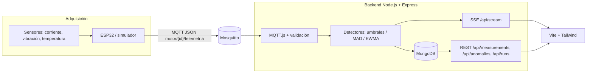

# Arquitectura y flujo del dato

**Flujo:** (1) el microcontrolador muestrea y publica JSON por MQTT → (2) Mosquitto transporta →
(3) el backend valida el mensaje → (4) los detectores lo analizan → (5) se guarda la medición
(y el evento si hay alerta) en MongoDB → (6) se retransmite al navegador por SSE →
(7) el historial se consulta por REST.

**Separación de responsabilidades:** adquisición (`firmware/`, `simulator/`), transporte (Mosquitto),
análisis (`backend/src/detectors`), almacenamiento (`backend/src/models.js`), presentación (`frontend/`).
